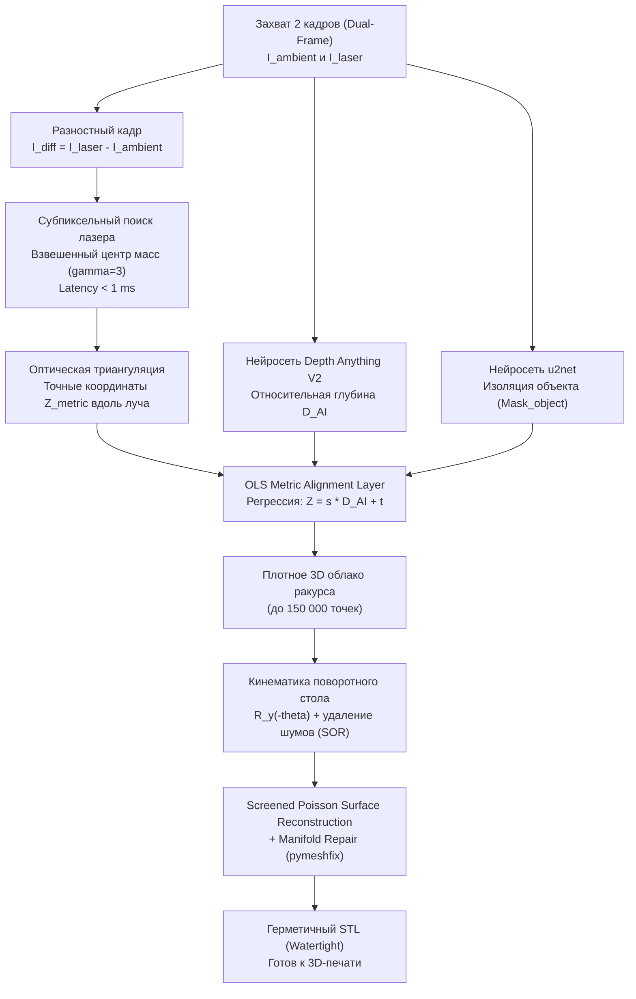

# NeuralScan: Edge-AI Hybrid 3D Metrology Scanner

<div align="center">

[](https://contest.bhuntr.com/en/39jg9vimiynrhlksze/home/)
[](firmware/)
[](ai/)
[-brightgreen.svg?style=for-the-badge)](test_pipeline.py)
[](output/models/)

**Демократизация высокоточной 3D-метрологии: открытый аппаратный стенд за $30 и гибридный Edge-AI на платформе ASUS.**

[Документация к презентации](docs/presentation_guide.md) • [Сценарий питча](docs/pitch_deck_script.md) • [Быстрый старт](#5-быстрый-старт-quickstart) • [Бенчмарк ASUS](#4-аппаратное-обоснование-asus-ugen-ai-league)

</div>

---

## 1. Концепция и проблематика

### Проблема индустрии
Промышленные оптические 3D-сканеры (GOM ATOS, Creaform HandySCAN, Keyence) стоят от **$3 000 до $25 000 USD**. Их запредельная стоимость обусловлена дорогой прецизионной оптикой, телецентрическими линзами, лазерными проекторами со сложной схемой гальванометров и оптическими энкодерами высокого разрешения.

Альтернативы несовершенны:
* **Классическая фотограмметрия** (Meshroom, RealityCapture) требует сотен снимков, вычислений на полчаса и **полностью отказывает** на монохромных, гладких или текстурно-однородных объектах (белый пластиковый цилиндр, шестерня, матовый металлический фланец). Кроме того, она не имеет информации об абсолютном масштабе.
* **Бюджетные триангуляционные сканеры** сканируют объект полоса за полосой в течение 30–40 минут.

### Наше решение: NeuralScan
**NeuralScan** устраняет необходимость в дорогой оптике, перенося оптическую сложность в **локальное ядро искусственного интеллекта на ноутбуке ASUS**:
1. **Стенд за $30:** Arduino Uno R3, редукторный шаговый двигатель 28BYJ-48 с драйвером ULN2003, лазерная линия KY-008 (650 нм) и обычная камера смартфона/веб-камера.
2. **Монокулярный Edge-AI (Depth Anything V2):** мгновенно строит плотную карту глубин видимой поверхности объекта.
3. **Слой метрического выравнивания (OLS Metric Alignment Layer):** устраняет неопределенность масштаба (*scale ambiguity*) монокулярной нейросети, используя точные субпиксельные координаты лазерной линии для мгновенной привязки к реальным миллиметрам.
4. **Гарантированно герметичный STL (Watertight):** реконструкция поверхности Screened Poisson и топологическая коррекция гарантируют замкнутую 2-многообразную сетку, готовую к немедленной 3D-печати и реверс-инжинирингу.

---

## 2. Аппаратная архитектура и Bill of Materials ($30 BOM)

```
                 +-------------------------------------------------+
                 |            ASUS PC / Edge AI Host               |
                 | (NVIDIA RTX 4060 / Intel NPU, PyTorch CUDA FP16)|
                 +-----------------------+-------------------------+
                                         |
                       +-----------------+-----------------+
                       | USB UART (115200)                 | USB / Wi-Fi Video (1080p)
                       v                                   v
            +----------------------+            +----------------------+
            |    Arduino Uno R3    |            |  Smartphone / Webcam |
            |    + ULN2003 Board   |            |  (Fixed Focus/Exp)   |
            +----------+-----------+            +----------+-----------+
                       |                                   |
             +---------+---------+                         |
             |                   |                         v
             v                   v             [Объект на расстоянии 30 см]
    +-----------------+ +-----------------+                ^
    | 28BYJ-48 Motor  | |  KY-008 Laser   |                |
    | (2048 steps/rev)| | Line Projector  |----------------+
    | Поворотный стол | | (650nm Red Line)| (Лазерная полоса)
    +-----------------+ +-----------------+
```

### Спецификация компонентов (BOM)

| Компонент | Назначение | Примерная стоимость |
| :--- | :--- | :--- |
| **Arduino Uno R3** (или Mega 2560) | Управление столом и TTL-сигналом лазера | $4.50 (≈ 420 руб) |
| **Шаговый мотор 28BYJ-48 + ULN2003** | Прецизионное вращение стола (2048 шагов/оборот) | $2.80 (≈ 260 руб) |
| **Лазерный модуль KY-008 (650 нм)** | Проекция тонкой оптической реперной линии | $1.20 (≈ 110 руб) |
| **Цилиндрическая линза / диффузор** | Формирование плоской лазерной плоскости | $0.80 (≈ 75 руб) |
| **Камера смартфона** (Iriun Webcam / USB) | Захват кадров высокой четкости (1080p) | $0.00 (уже есть у каждого) |
| **Корпус поворотного стола** | Напечатан на 3D-принтере (PLA пластик, 150 г) | $3.50 (≈ 320 руб) |
| **Блок питания 5V / USB кабели** | Питание электроники | $3.00 (≈ 280 руб) |
| **ИТОГО:** | **Полноценный измерительный комплекс** | **~ $15.80 – $30.00 USD** |

> **Защита электроники от перегрева:** в прошивке [`firmware/uln2003_stepper_controller/`](firmware/uln2003_stepper_controller/) реализовано автоматическое обесточивание всех 4 обмоток двигателя сразу после завершения шага (`digitalWrite(8..11, LOW)`). Драйвер и двигатель остаются холодными при бесконечном цикле работы.

---

## 3. Математическое ядро и алгоритмы



### 3.1. Аналитическое субпиксельное извлечение лазера (< 1 мс)
Вместо медленных детекторов объектов мы применяем субпиксельный взвешенный центр масс с обостряющей степенью $\gamma = 3$:

$$x_c(y) = \frac{\sum_{x \in W} x \cdot (I_{\text{diff}}(x, y))^\gamma}{\sum_{x \in W} (I_{\text{diff}}(x, y))^\gamma}$$

где $I_{\text{diff}} = I_{\text{laser\_on}} - I_{\text{ambient}}$, а $W$ — окрестность максимальной яркости.

Физическая глубина лазерных точек рассчитывается по формуле оптической триангуляции:

$$Z_{\text{metric}}(x_c, y) = \frac{b \cdot f}{(x_c - x_0) + f \cdot \tan(\alpha)}$$

* $b = 160\text{ мм}$ — базовая линия между камерой и лазером,
* $f = 1620\text{ px}$ — фокусное расстояние объектива,
* $\alpha = 28.5^\circ$ — угол схождения лазерной плоскости,
* $x_0 = 960\text{ px}$ — оптический центр матрицы (1080p).

### 3.2. Слой метрического выравнивания (OLS Metric Alignment Layer)
Монокулярная нейросеть `Depth Anything V2` вычисляет относительный рельеф поверхности $D_{\text{AI}} \in [0, 1]$. Для перевода всего массива пикселей объекта в физические миллиметры мы сопоставляем точки лазерного луча $\{(D_{\text{AI}}(x_c, y), Z_{\text{metric}}(x_c, y))\}$ и находим калибровочные коэффициенты методом наименьших квадратов (Ordinary Least Squares):

$$s = \frac{\text{Cov}(D_{\text{AI}}, Z_{\text{metric}})}{\text{Var}(D_{\text{AI}})}, \quad t = \bar{Z}_{\text{metric}} - s \cdot \bar{D}_{\text{AI}}$$

Плотная метрическая глубина всей видимой поверхности:

$$Z_{\text{dense}}(x, y) = s \cdot D_{\text{AI}}(x, y) + t \quad \forall (x, y) \in \text{Mask}_{\text{object}}$$

### 3.3. 3D-кинематика и реконструкция поверхности
1. **Объединение ракурсов:** точки каждого углового шага $\theta_k$ трансформируются в каноническую систему координат оси столика:
   $$\mathbf{p}_{\text{world}} = \mathbf{R}_y(-\theta_k) \cdot (\mathbf{p} - \mathbf{C}_{\text{table}})$$
2. **Фильтрация шумов:** воксельная сетка (Voxel Grid 0.8 мм) + статистическое удаление выбросов (SOR, 20 соседей, $2.0\sigma$).
3. **Screened Poisson Reconstruction:** построение гладкого непрерывного полигонального поля (Octree Depth 8–9).
4. **Топологическое закрытие (Watertight Manifold):** автоматическое исправление ориентации нормалей и сшивка отверстий с помощью `pymeshfix` гарантируют пригодность модели для слайсеров 3D-принтеров.

---

## 4. Аппаратное обоснование (ASUS UGen AI LEAGUE)

Проведены прямые замеры производительности инференса на рабочей станции с мобильным GPU (ASUS-класс оборудования):

```
======================================================================
  ASUS UGen AI LEAGUE: HARDWARE ACCELERATION JUSTIFICATION BENCHMARK
======================================================================
[1/2] NVIDIA RTX 4060 Laptop GPU (CUDA FP16 Tensor Cores):
  -> Latency per frame:   72.17 ms
  -> Throughput:          13.9 FPS (Интерактивная квази-реалтайм метрология)

[2/2] Host CPU Sequential Inference (x86 Float32):
  -> Latency per frame:   1 360.11 ms (1.36 секунды на один ракурс)
  -> Throughput:          0.74 FPS (Критическое зависание системы)
----------------------------------------------------------------------
  ИТОГ УСКОРЕНИЯ:
  - Коэффициент ускорения (GPU vs CPU):  18.8x БЫСТРЕЕ
  - Расчет 48 ракурсов на CPU:          65.3 секунды
  - Расчет 48 ракурсов на Edge GPU:     3.5 секунды
  - Вывод: Edge-ускорители ASUS превращают научный алгоритм в практичный
           быстрый инструмент реального времени.
======================================================================
```

### Преимущества локального Edge-AI:
* **Абсолютная конфиденциальность:** 100% данных и CAD-файлов обрабатываются локально. Коммерческая тайна и чертежи деталей не покидают ноутбук ASUS.
* **Автономия:** сканер не требует интернета и может работать в полевых условиях или в изолированных цехах.
* **Энергоэффективность:** поддержка современных инструкций NPU позволяет в будущем снизить энергопотребление до <10 Вт.

---

## 5. Быстрый старт (Quickstart)

### 5.1. Установка окружения

```powershell
# 1. Клонировать репозиторий
git clone https://github.com/Issabek-UN1/neuralscan.git
cd neuralscan

# 2. Создать и активировать виртуальное окружение Python (рекомендуется Python 3.11)
python -m venv venv
.\venv\Scripts\Activate.ps1

# 3. Установить зависимости
pip install -r requirements.txt
```

### 5.2. Прошивка микроконтроллера
1. Откройте файл [`firmware/uln2003_stepper_controller/uln2003_stepper_controller.ino`](firmware/uln2003_stepper_controller/uln2003_stepper_controller.ino) в Arduino IDE.
2. Выберите плату: **Arduino Uno** (или Mega 2560).
3. Нажмите кнопку **Upload** (Загрузить).
4. **Важно:** закройте «Монитор порта» (Serial Monitor) в Arduino IDE перед запуском Python-скрипта.

### 5.3. Прицеливание камеры (Live Targeting Preview)
Перед запуском сканирования убедитесь, что камера наведена на объект и он находится в центре:

```powershell
# Просмотр видеопотока с прицельным перекрестием (для камеры 1 - смартфона)
python main.py --preview --cam 1
```
*Цилиндр/объект должен быть по центру перекрестия на расстоянии около 30 см. Нажмите `Q` для выхода.*

### 5.4. Запуск 3D-сканирования

```powershell
# Реальное сканирование на 8 ракурсов (шаг 45 градусов) с сохранением кадров:
python main.py --cam 1 --steps 8 --save-frames

# Высокодетализированное сканирование на 48 шагов (шаг 7.5 градусов):
python main.py --cam 1 --steps 48

# Возврат поворотного стола в исходное нулевое положение:
python main.py --home

# Запуск официального бенчмарка сравнения скорости CPU vs GPU для жюри:
python main.py --benchmark
```

### 5.5. Режим виртуальной симуляции (Mock Mode)
Если под рукой нет физического стенда, пайплайн можно протестировать на встроенной виртуальной 3D-мишени:
```powershell
python main.py --mock --steps 8
```

---

## 6. Автоматическая верификация (Unit Tests)

Все компоненты пайплайна протестированы строгим набором юнит-тестов:

```powershell
python test_pipeline.py
```

```
[TEST 1/7] Hardware Serial Controller (Mock Simulation)...    -> PASSED
[TEST 2/7] Camera Stream & Dual-Frame Acquisition...          -> PASSED
[TEST 3/7] Analytical Subpixel Laser Extraction (< 1 ms)...   -> PASSED
[TEST 4/7] Foreground Object Segmentation (u2net)...          -> PASSED
[TEST 5/7] Monocular Relative Depth (Depth Anything V2)...    -> PASSED
[TEST 6/7] Metric Alignment Layer (Scale Resolution)...       -> PASSED
[TEST 7/7] Multi-View Integration & Watertight STL...         -> PASSED
----------------------------------------------------------------------
Ran 7 tests in ~14.5s (100% OK)
```

---

## 7. Структура репозитория

```
f:\scan3d\
├── ai/                           # Модули искусственного интеллекта
│   ├── background_remover.py     # Сегментация u2net (Rembg)
│   └── depth_estimator.py        # Depth Anything V2 (CUDA FP16)
│
├── vision/                       # Компьютерное зрение и оптика
│   ├── camera_stream.py          # Захват кадров (DirectShow / OpenCV)
│   └── laser_tracker.py          # Аналитический субпиксельный поиск лазера (< 1 мс)
│
├── fusion/                       # Слияние геометрии и метрики
│   └── metric_aligner.py         # OLS регрессия масштаба и обратная проекция
│
├── reconstruction/               # 3D-реконструкция и CAD-экспорт
│   ├── cloud_integrator.py       # Объединение ракурсов R_y(theta) и фильтрация SOR
│   └── mesh_exporter.py          # Screened Poisson и топологический ремонт STL
│
├── hardware/                     # Драйверы взаимодействия с периферией
│   └── serial_controller.py      # UART протокол управления столом и лазером
│
├── firmware/                     # Исходный код микроконтроллеров
│   ├── uln2003_stepper_controller/   # Прошивка для Arduino Uno + 28BYJ-48 (Основная)
│   └── l298p_stepper_controller/     # Прошивка для Arduino Mega + L298P (Альтернативная)
│
├── docs/                         # Материалы к хакатону ASUS
│   ├── presentation_guide.md     # Послайдовая инструкция для создания презентации
│   └── pitch_deck_script.md      # Текст питча для спикера и ответы на вопросы жюри
│
├── output/                       # Результаты сканирования
│   ├── frames/                   # Сохраненные кадры с лазером и без
│   └── models/                   # Готовые 3D-модели
│       ├── neuralscan_model.stl  # Watertight бинарный STL (для 3D-печати)
│       └── neuralscan_cloud.ply  # Плотное цветное облако точек
│
├── config.py                     # Конфигурация геометрии стенда и оптических параметров
├── main.py                       # Главный CLI-оркестратор и бенчмарк
├── test_pipeline.py              # Автоматический тестовый комплекс (7/7 тестов)
└── requirements.txt              # Список зависимостей Python
```

---

## 8. Лицензия и участие в хакатоне

Проект разработан специально для конкурса **ASUS UGen AI LEAGUE** (трек Edge AI / Smart AIoT).  
Код распространяется под лицензией [MIT License](LICENSE).
